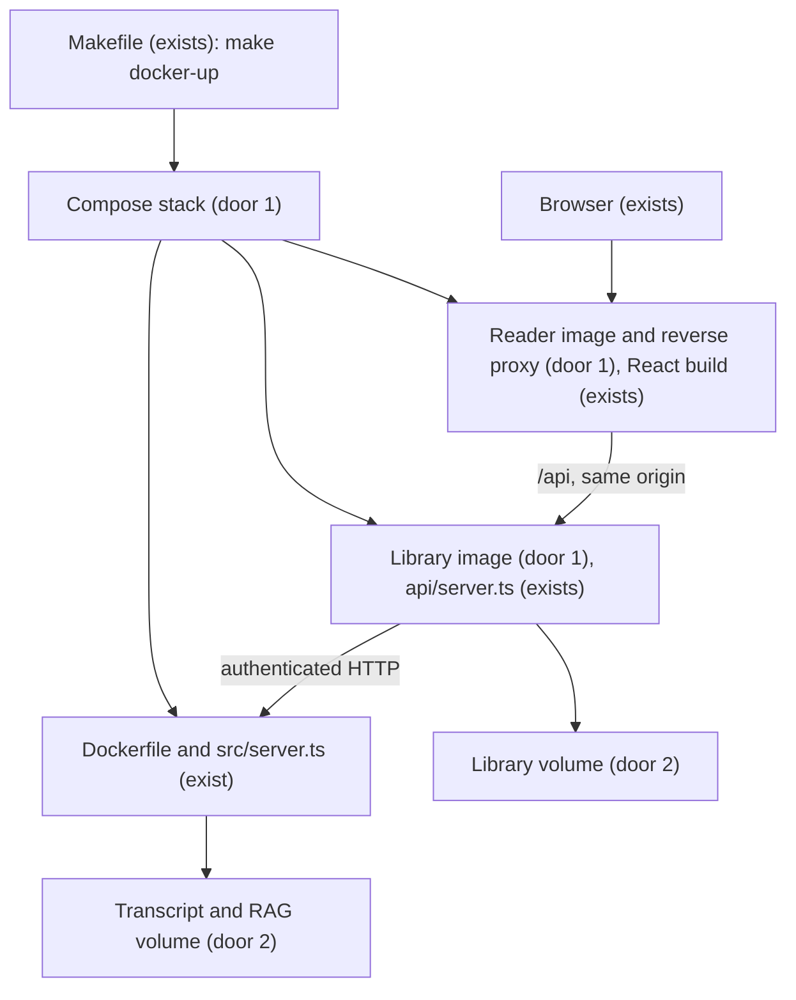

# Run every application in Docker on WSL2

## Problem

The owner must manage Node, media binaries and three host processes to run the complete product.
A Dockerfile exists for the transcript API, but the channel library and reader have no container
entry points. The owner requested a tlc-spec-lean task for Dockerfiles for all applications after
the individual-video repair, following the earlier request for one command and combined logs.
No usage metrics were supplied. The owner approved implementation on 2026-10-05.

At planning time Docker was unavailable in this shell. On 2026-10-05 the Docker CLI, Compose
and engine are installed. The current login lacks the newly assigned docker group; `sg docker`
can access the engine without changing permissions. Verification must exercise actual containers.

The intended result is a locally runnable three-service stack with one start command, visible
logs, durable library data and ports that coexist with other local applications.

## Flow

Reuse the existing transcript image, Fastify applications, React production build, credentials,
provider adapters and storage contracts; containerization does not create another processing path.

The start command checks Docker/Compose availability and the two environment files, builds and
starts the three services, waits for health, prints the actual browser URL, then follows all logs.
An interrupt stops this Compose project's containers without deleting persistent volumes.
The selected host web port is independent of the internal service addresses. Restart, failed
startup, credential routing, persistence and browser admission are validated through this flow.

## Impact

| Front | What changes |
| --- | --- |
| execution | Add container operation for transcript API, library API and reader; retain the host `make dev` workflow. |
| packaging | Reuse the root transcript Dockerfile and its native/model assets; add separate library and frontend Dockerfiles with application-scoped build contexts. |
| network | Reader proxies `/api` to `library:3100`; library calls `http://transcript:3000`. Only the reader publishes a host port by default. |
| configuration | Reuse root `.env` and `services/channel-library/.env`; override host-only paths and addresses in container runtime configuration. Frontend receives no secrets. |
| stored data | No schema migration. New named volumes isolate container storage from the running host library. Existing host data is not imported automatically. |
| operational behavior | Startup/readiness, provider failures and request logs remain visible with service labels. A healthy container does not imply a successful external LLM request. |
| existing deployment | Preserve the root Dockerfile's current production entry point, native dependencies and pinned encoder artifacts; no deployment changes. |
| WSL | Document Docker Desktop Linux-container mode and integration with this distribution; verify CLI, Compose and engine access before a runtime proof. |

## Relations

None - no stored-data shape change. Existing single-writer ownership and data retention apply:
one library worker owns its library volume; one transcript process owns its job/RAG volume.
Compose project isolation prevents accidental reuse of a different project's named volumes.

## Surface

None - no application HTTP signatures change. The reader forwards existing `/api/v1/*` routes
and their existing success/error status codes without changing authentication or response bodies.
The operational command interface is specified in Criteria and Observable.

## Landing

| One-way door | Literal shape | Alternative rejected |
| --- | --- | --- |
| 1: complete local container stack | Root `compose.yaml` with services `transcript`, `library`, `web`; root `Dockerfile` retained, plus `services/channel-library/Dockerfile` and `services/channel-library/web/Dockerfile`; same-origin proxy `/api` → `http://library:3100`; `TRANSCRIPT_API_URL=http://transcript:3000`. | One container running three processes hides independent readiness/shutdown and does not provide the requested application images. |
| 2: durable container data | Project-scoped named volumes `transcript-data` mounted at `/data` and `library-data` at `/data/library`; runtime `DATA_ROOT=/data/transcripts`, `RAG_DATA_ROOT=/data/lancedb`, `LIBRARY_DATA_DIR=/data/library`; one writer per volume. | Binding the existing host `.data` directories by default would allow the host launcher and containers to write the same SQLite/job stores concurrently. |
| 3: local operator commands and ports | `make docker-up`, `make docker-down`, `make docker-logs`, `make docker-status`; default loopback-only dynamically allocated host port for web container port 8080, optional explicit `DOCKER_WEB_PORT`; actual URL printed after startup. | Fixed default host ports conflict with the owner's other local apps; silently killing an existing listener is unacceptable. |

After approval, record the container storage and networking precedent in STATE.md. Choose a
supported pinned lightweight static-server image during implementation; no new npm runtime
package or external database is required. Preserve AD-006 through AD-016 and AD-018.

## Criteria

### S1: Start, use and stop the complete stack (P1)

**Acceptance Criteria**

1. WHEN each application image is built from a clean checkout THEN its Dockerfile SHALL install locked dependencies and produce a runnable Linux amd64 image without host `node_modules` or host build outputs.
2. WHEN `make docker-up` runs with a working Docker engine, Compose v2 and valid environment files THEN it SHALL start the `transcript`, `library` and `web` services together.
3. WHEN the stack starts THEN it SHALL wait up to 180 seconds after the build for all three local health checks before printing the ready browser URL.
4. IF Docker, Compose, engine access or a required environment file is absent THEN the start command SHALL exit nonzero with the missing prerequisite named and no credential values printed.
5. WHEN the default web host port is allocated THEN the stack SHALL bind it to loopback and print the actual browser URL even when 3000, 3100, 5173 and 8080 are already occupied.
6. IF an explicit `DOCKER_WEB_PORT` is invalid or unavailable THEN startup SHALL exit nonzero naming that port configuration without stopping its current listener or rewriting an environment file.
7. WHEN the browser calls the existing library API through the web container THEN the reverse proxy SHALL preserve the path, authorization header, request body and API response status.
8. WHEN the library submits a transcript job THEN it SHALL reach the transcript service using its internal Compose address and the existing bearer-token contract.
9. WHILE `make docker-up` is attached THEN it SHALL stream stdout/stderr from all three services with service labels, including library request and processing diagnostics.
10. WHEN the owner interrupts the attached command or runs `make docker-down` THEN the stack SHALL stop only this project's containers and retain its named volumes.
11. IF startup fails after creating part of the stack THEN the launcher SHALL exit nonzero and stop containers created by that invocation without deleting stored data or stopping unrelated projects.
12. WHEN `make docker-status` or `make docker-logs` is run THEN it SHALL display this project's container health/ports or combined logs respectively without starting a second stack.

**Independent test:** Build all three images and run the stack on a WSL2 Docker engine. Occupy
the usual host ports, start with a controlled provider fixture, confirm readiness, actual URL,
authenticated browser admission and internal transcript routing, then interrupt and inspect
remaining containers and volumes. Exercise missing-engine and failed-start paths separately.

### S2: Preserve data, secrets and existing behavior (P1)

**Acceptance Criteria**

13. WHEN the containers are removed and recreated without deleting volumes THEN saved library videos, originals, enrichment, favorites and notes SHALL remain available with the same values.
14. WHEN the container stack starts alongside `make dev` THEN its named data volumes SHALL remain independent of the host application data directories.
15. WHEN images are built or frontend assets are served THEN `.env` files, bearer tokens, provider keys and local library data SHALL be absent from image layers and browser assets.
16. WHEN processes serve requests THEN their runtime user SHALL be non-root with write access limited to required runtime directories and mounted application storage.
17. IF an external provider rejects or times out during processing THEN the existing status, readable saved original and sanitized diagnostics SHALL remain accessible through the containerized reader.
18. WHEN `make dev` is used after this feature THEN its existing automatic port selection and host-process lifecycle SHALL remain unchanged.
19. WHEN the owner follows the run guide THEN it SHALL provide WSL integration checks, the two required environment files, start/status/log/stop commands, storage backup/restore instructions and an explicit warning that volume deletion removes saved data.
20. WHEN container verification is reported THEN it SHALL distinguish working image/HTTP/browser proofs from live-provider success and record unavailable Docker/WSL prerequisites as blockers rather than passes.

**Independent test:** Save reading state through a real containerized API/browser, recreate the
stack and compare values. Inspect image contents and frontend assets using fixture credentials,
verify runtime UIDs, run the existing host launcher regressions and exercise a controlled
provider timeout. Perform a separate optional live-provider probe without treating its failure
as proof of a container-network defect.

## Out of scope

| Excluded | Why |
| --- | --- |
| Automatic Windows Docker Desktop installation, account enrollment or license acceptance | This request creates the application-container task; host installation requires a separate explicit action and may require Windows interaction. |
| Production deployment, registry publishing or changes to existing hosting | The target is local WSL2 execution. |
| Hot-reload development inside containers | The existing host `make dev` remains the development workflow; first container delivery runs production builds. |
| Multiple writer replicas or shared host/container databases | Existing stores support one writer per data directory. |
| Automatic import of the current host library into named volumes | Avoid overwriting or sharing owner data; document an explicit stopped-service backup/restore procedure. |
| Fixing external provider latency or changing the chosen LLM | Independent of packaging; the preceding repair produced a saved summary and corrected transcript for the real video. |

## Assumptions

| Assumption | Chosen default | Rationale | Confirmed? |
| --- | --- | --- | --- |
| Host prerequisites | Target Docker Desktop with WSL2 integration; retain compatibility with a working Linux Docker Engine. | The owner explicitly asked about WSL, and a Desktop mount is present. | n |
| Build resources | Permit network access for npm, base images and the existing pinned encoder download. | The transcript image already downloads model/native assets during build. | n |

**Open questions:** none - implementation approved on 2026-10-05. Run all runtime proofs using
the installed engine; do not confuse a container health check with a live-provider proof.

## Observable

| Surface | Decision | Landing |
| --- | --- | --- |
| start command | defaults, port override, readiness and URL output | AC 2–6; door 3. |
| start command | partial failure and exit code | AC 4, AC 6, AC 11. |
| attached terminal | verbosity, combined logs and interrupt | AC 9–10. |
| status/log commands | output and project scope | AC 12. |
| stop command | destructive confirmation | AC 10; stopping retains volumes, volume deletion has no automatic command. |
| reader/API | empty, loading, errors and unauthorized states | existing reader behavior preserved through AC 7–8, AC 17; no new screen. |
| API | response shape, versioning, rate limits | existing `/api/v1` contract and hooks; AC 7–8. |
| images | secrets and local-data exclusion | AC 15; controlled fixture inspection. |
| stored collections | identity, grouping and ordering | existing schema-3 Store behavior; AC 13–14, no schema changes. |
| run guide | English structure, WSL preparation and next steps | AC 19–20. |
| UI design | density, arrangement and new navigation | n/a - no reader design changes. |

## Sources

- Owner request on 2026-10-04: after repairing individual-video support, create a
  `tlc-spec-lean` task for Dockerfiles for all applications; earlier request establishes combined
  startup/logs and coexistence with occupied local ports.
- Repository `AGENTS.md`, `.specs/STATE.md`, root `Dockerfile`, `docker-entrypoint.sh`,
  `services/channel-library/api/server.ts`, `scripts/dev.mjs`, and `docs/running-all-services.md`
  bind existing architecture, storage, logging and startup behavior.
- Official [Docker WSL2 integration](https://docs.docker.com/desktop/features/wsl/),
  [Compose services](https://docs.docker.com/reference/compose-file/services/) and
  [health-based startup ordering](https://docs.docker.com/compose/how-tos/startup-order/)
  document the container/runtime mechanisms; opened while preparing this plan.
