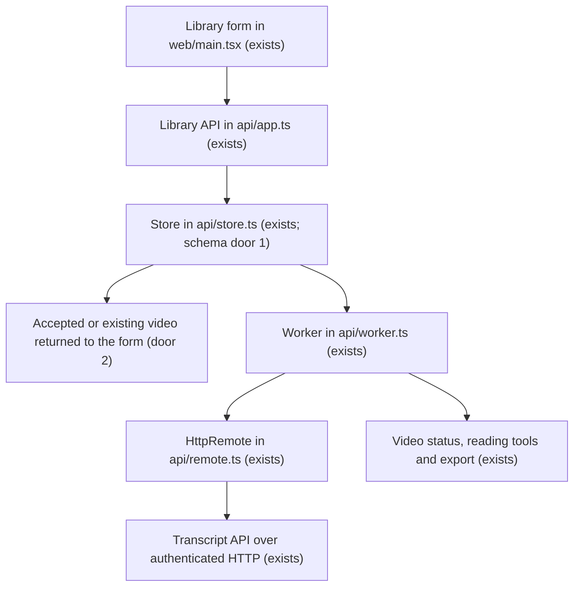

# Add an individual YouTube video

## Problem

The library accepts channel URLs and queues their recent videos, but the owner cannot add one
specific video from its URL. The owner requested this alongside channel registration and wants
to be told when the control is visible and ready to test. No usage metrics were supplied.

The owner will paste a video URL on the library screen, queue that video, and open its processing
status and reading content without subscribing to its channel.

## Flow

Reuse the existing authenticated library API, SQLite store, per-video worker, transcript HTTP
adapter, retry handling, reading screen and session guards.

URL validation stays within the independent library application, matching the existing transcript
API's recognized YouTube URL families. A local database transaction resolves duplicate video IDs
before the worker sees them. Admission makes no external metadata request.

## Impact

| Front | What changes |
| --- | --- |
| domain | A library video can exist without a followed channel. Collection runs still belong to actual followed channels. |
| stored data | Schema 3 allows unattached videos while preserving all existing rows and foreign-key relationships. Back up the stopped library before upgrade; older schema-2 binaries cannot reopen schema 3. |
| library contracts | Video responses permit an absent channel association and unknown publication date, and expose an addition timestamp. Existing channel-derived metadata remains valid. |
| UI | The library gains an Add video form above filters, including the empty state; manual entries show their addition date instead of an invented publication date. |
| channel collection | Discovery of a previously imported video fills its known channel metadata without duplicating it or restarting its processing. |
| configuration | The existing two environment files and processing credentials suffice; no extra YouTube API key is required for admitting a video URL. |

## Relations

A followed Channel has zero or more Videos. A Video belongs to zero or one followed Channel.
An unattached Video can later be associated with a followed Channel by actual discovery.
The video ID remains unique across both admission paths. Original transcripts, editorial results,
reading state and attempts continue to belong to that same video identity.

## Surface

| Route | In | Out | Status |
| --- | --- | --- | --- |
| `POST /api/v1/videos` | `url` | `video`, `created` | 202 new, 200 existing, 400 invalid, 401 unauthorized, 413 oversized, 429 rate limited, 503 configuration/storage failure |
| `GET /api/v1/videos` | existing filters | existing list with extended Video shape | 200, 400, 401, 503 |
| `GET /api/v1/videos/:videoId` | existing ID | existing detail with extended Video shape | 200, 400, 401, 404, 503 |

Errors retain the existing `{ error: { code, message }, requestId }` envelope and Retry-After
behavior. Existing protected route hooks apply to the new POST.

## Landing

| One-way door | Literal shape | Alternative rejected |
| --- | --- | --- |
| 1: stored unattached videos | SQLite `PRAGMA user_version = 3`; `videos.channel_id` becomes nullable while retaining its foreign key; `youtube_video_id` remains the primary key. | A synthetic or automatically followed channel would misrepresent subscriptions and could schedule unrequested videos. |
| 2: admission and video response contract | `POST /api/v1/videos` accepts `{ url: string }`; returns `{ video, created: true }` with 202 or `{ video, created: false }` with 200. Video uses `channelId: string \| null`, `publishedAt: string \| null`, `addedAt: string`. | Requiring a channel or publication date at admission would require a new metadata provider before a valid link could enter the existing worker. |

The stored-shape decision will be recorded in STATE.md when approved. No new package dependency.

## Criteria

### S1: Add and read one video (P1)

**Acceptance Criteria**

1. WHEN an owner submits a supported HTTPS YouTube URL THEN the library SHALL normalize it to one 11-character video ID. Supported paths are watch, youtu.be, shorts, live and embed on the transcript API's existing allowed hosts; timestamp and playlist query parameters do not add extra videos.
2. WHEN a valid new video is submitted THEN the library SHALL persist one pending video and return 202 with `created: true`, without creating a channel or collection run.
3. WHEN the same video is submitted again or concurrently THEN the library SHALL return the existing video with 200 and `created: false`, without replacing its status, transcript, enrichment or reading state.
4. IF the URL/body is invalid THEN the library SHALL return 400 with `INVALID_REQUEST` and persist no video. Reject missing/non-string/empty/over-2048-character URLs, unknown fields, unrelated hosts, credentials, explicit non-default ports, unsupported schemes and malformed IDs.
5. WHEN the new route is requested THEN the library SHALL enforce the existing owner authentication, body-size and 30-mutations-per-minute limits, with the statuses in Surface.
6. WHEN the worker admits a pending individual video THEN it SHALL use the existing transcription and enrichment stages, persistence, restart recovery and retry handling, including failed/unavailable states and readable originals if enrichment fails.
7. WHEN the unlocked library screen is displayed THEN it SHALL show an input labeled `YouTube video URL` and an `Add video` button above the filters, both with and without saved videos; channel registration remains available.
8. WHILE video admission is pending THEN the form SHALL disable repeated submission and show `Adding video…`; on success it opens the returned video, and on failure it preserves the input and displays the API error. A 401 uses the existing access screen and session isolation.
9. WHEN an unattached video has no provider metadata THEN the library SHALL display `YouTube video <id>` as its title, `Added individually` as its source label and its addition date labeled `Added`, without presenting an invented channel or publication date.
10. WHEN channel discovery later returns an unattached video THEN the store SHALL attach its channel and discovered title/publication/thumbnail metadata while preserving the same video, saved content, reading state and processing progress.
11. WHEN a schema-1 or schema-2 library is upgraded THEN migration SHALL preserve channel/video/source/enrichment/reading/attempt/chunk/collection data and references, complete atomically at schema 3, and reopen without reapplying changes. New empty stores start at schema 3.
12. WHEN an individual video is opened or revisited THEN it SHALL support the existing favorites, read state, notes, filtering, retry and Markdown export, including after restart; mixed lists sort by known publication date or addition date with video ID as a stable tie-breaker.
13. WHEN the feature is available for owner testing THEN the run guide SHALL explain where to add one video, duplicate handling, the two env files and their required/optional credentials, and the migration backup requirement; the owner is notified only after the visible browser flow and independent verification pass.

**Independent test:** In an isolated browser fixture, unlock an empty library, submit a video URL,
observe the queued item, reach readable fixture content, submit an equivalent URL and verify one
record. Cover invalid input, failure and unauthorized states, reload/persistence, channel discovery
of the same video, and keyboard/mobile layout. Use controlled provider fixtures for automated
proof; live YouTube/OpenCode success is a separate owner test, not inferred from fixture results.

## Out of scope

| Excluded | Why |
| --- | --- |
| Playlist/batch import and automatic channel subscriptions | This request adds one specified video alongside the existing channel workflow. |
| A new metadata scraping provider | Admission must work with the current RSS/no-YouTube-key setup; unknown metadata is labeled honestly. |
| Reprocessing on duplicate submission | Existing Retry processing is the explicit recovery action. |
| New credentials, login system or deployment | Existing owner access and local launcher cover this flow. |

## Assumptions

| Assumption | Chosen default | Rationale | Confirmed? |
| --- | --- | --- | --- |
| Initial title | Use the video ID in a placeholder title until existing channel discovery supplies metadata. | The current transcript contract does not return a title or channel; this keeps URL admission independent of a new provider. | n |
| Testing notification | Notify in this conversation after the control is visible and browser-tested; provide the local entry point and short test instructions. | This matches the owner's request to try the feature when it appears. | n |

**Open questions:** none - defaults above remain visible for review.

## Observable

| Surface | Decision | Landing |
| --- | --- | --- |
| library screen | empty and populated arrangement | AC 7; form above existing filters in both states. |
| library screen | loading and repeated submission | AC 8; pending label and disabled submit. |
| library screen | errors and unauthorized state | AC 8; preserve input and reuse session guard. |
| library screen | success and duplicates | AC 3, AC 8; open the returned single video. |
| video card/detail/export | unknown metadata and date labels | AC 9, AC 12. |
| library screen | destructive action confirmation | n/a - this feature introduces no destructive owner action. |
| POST video API | response/error format and versioning | Surface, door 2, AC 2–5; existing v1 envelope. |
| POST video API | access, limits and retry-after | AC 5; existing hooks. |
| stored collections | grouping, order and duplicate identity | Relations, AC 3, AC 10, AC 12. |
| run guide | English steps, configuration and owner testing | AC 13. |

## Sources

- Owner request on 2026-10-04: accept a specific video link alongside channels; notify when visible
  to test; explain all environment files required.
- `services/channel-library/api/store.ts`, `api/worker.ts`, `web/main.tsx` and
  `src/domain/youtube-url.ts`: current persistence, processing, UI and URL conventions.
- `.specs/STATE.md`: AD-013 English technical content, AD-014 pinned workflow, AD-015 independent
  library, AD-016 durable single-writer store and AD-017 preserved reading/source data.
