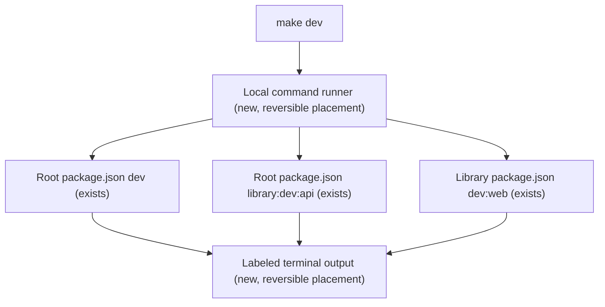

# Run all applications from one terminal

## Problem

`docs/running-all-services.md` currently says: "Development uses three terminals; keep all three
running at the same time." The owner has to start and stop each process separately and switch
terminals to follow their output. The requested outcome is one command with all applications
and their process output visible together.

## Flow

Reuse the existing npm development commands and their service-specific environment loading.

The runner manages launch, labeled output, command exit reporting and group shutdown.
The run guide explains prerequisites, the single command, and how to stop the session.

## Impact

| Front | What changes |
| --- | --- |
| local development | A root Makefile and a Node runner coordinate the three existing development commands. |
| domain | No domain terms or HTTP behavior change; workers continue inside their respective APIs. |
| stored data | No migration or cleanup; each service retains its existing working directory and storage configuration. |
| documentation | The existing run guide leads with the single-terminal workflow and retains individual commands for debugging. |
| dependencies | Use installed Node.js and make; no additional package or global process manager. |
| CI | The source job installs the existing library dependency tree so the combined-session HTTP test can launch all three processes. |

## Relations

None - no stored-data shape change.

## Surface

None - no HTTP routes or external payload signatures change. The local command behavior is
specified below.

## Landing

None - the local launcher and Makefile are removable wrappers around existing commands, with
no new dependency, persisted schema or externally consumed contract.

## Criteria

### S1: One development session (P1)

**Acceptance Criteria**

1. WHEN the owner runs `make dev` after setup THEN the launcher SHALL
   start the transcript API, library API and Vite reader concurrently from the repository root using the
   existing commands, with Vite receiving `--port 5173 --strictPort`.
2. WHEN launching each command THEN the launcher SHALL preserve its existing working directory,
   environment loading and inherited environment so relative storage and credentials resolve as
   they do under the individual commands.
3. WHEN a command starts, writes stdout or stderr, or exits THEN the launcher SHALL identify it
   as `transcript`, `library` or `web` in the shared terminal, including its PID on launch and its
   exit code or signal on exit. Launch reporting SHALL describe a started process, not claim
   that the service has passed a readiness check.
4. WHEN the launcher receives SIGINT or SIGTERM THEN it SHALL terminate all process groups it
   started, allow up to ten seconds for shutdown, and force termination of remaining group
   members before completing shutdown; unrelated process groups SHALL remain untouched.
5. IF a managed command fails to start or exits unexpectedly THEN the launcher SHALL
   identify the affected command, shut down the other managed groups with the same
   ten-second grace period, and cause `make dev` to exit nonzero.
6. WHEN the documented setup has completed THEN the combined session SHALL serve both existing
   API health endpoints and the reader with its authenticated Vite proxy at the documented
   addresses, as established by the existing local smoke procedure.
7. WHEN the owner reads `docs/running-all-services.md` THEN the guide SHALL explain `make dev`,
   labeled logs, one-session Ctrl+C shutdown, command-exit failure behavior and the existing
   prerequisites, while retaining the three individual commands for debugging.

**Independent test:** Launch the session after setup, observe output from all three labels,
run the guide's HTTP/proxy smoke procedure, then interrupt and confirm the managed processes
have exited. Exercise launch failure, unexpected command exit and a child ignoring termination
using isolated subprocess fixtures without provider calls or existing data.

## Out of scope

| Excluded | Why |
| --- | --- |
| Production supervision, containers and deployment | This request concerns the existing local development workflow. |
| New compiled-mode orchestration | The existing compiled-mode commands remain documented separately. |
| Automatic install, model downloads or credential creation on startup | Setup already has documented commands; startup reuses prepared dependencies and configuration. |
| Interactive process dashboard, CPU charts or separate terminal panes | Labeled concurrent logs and process lifecycle messages provide the requested shared view. |
| Application readiness monitoring and automatic restart policies | Existing health checks and development watchers remain responsible for their current behavior. A watcher can stay alive after its application child fails; this launcher reports command exits, not application health. |

## Assumptions

| Assumption | Chosen default | Rationale | Confirmed? |
| --- | --- | --- | --- |
| Host support | POSIX environments, including Linux and WSL; native Windows support is outside this change. | The repository's documented toolchain and current workspace use POSIX commands; process-group cleanup must be explicit. | n |
| Existing work | Preserve all current uncommitted application changes and historical specs. | This feature layers over the current documented workflow. | n |

**Open questions:** none - defaults are recorded above for plan review.

## Observable

| Surface | Decision | Landing |
| --- | --- | --- |
| command `make dev` | output format and verbosity | AC 3: continuous service output with labels, launch PIDs and exit results. |
| command `make dev` | flags and defaults | AC 1: no new required arguments; Vite port 5173 is strict. |
| command `make dev` | exit codes | AC 4 and AC 5: signal shutdown cleans up the session; command failure returns nonzero through make. Exact make signal codes remain make's behavior. |
| command `make dev` | partial startup and failure output | AC 5: identify the failing command and stop the remaining managed groups. |
| command `make dev` | readiness versus process state | AC 3 and AC 6: startup messages report process launches; existing HTTP probes establish service readiness. |
| run guide | structure, tone, depth and next action | AC 7: English operational instructions, setup before launch, smoke verification and stop instructions. |
| screen or API | new states, authorization and response contracts | n/a - this feature adds no screen or API route. |

## Sources

- User request: run all applications with one command and see the processes together; a Makefile
  is suggested as a possible entry point.
- `docs/running-all-services.md`: the three processes, prerequisites, ports, smoke procedure,
  environment separation and data retention.
- `.specs/STATE.md`: AD-013 English technical documentation, AD-014 pinned lean workflow,
  AD-015 independent library lifecycle and AD-016 single library writer.
